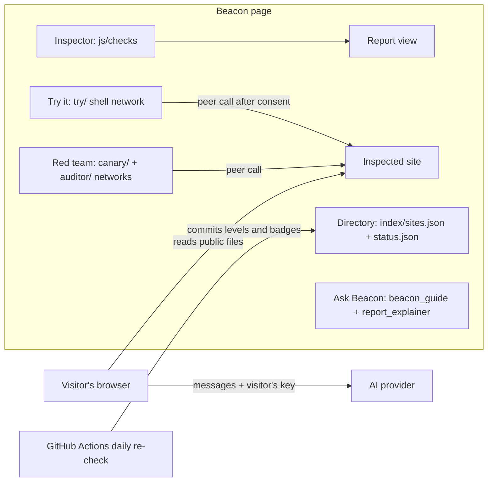

# Beacon technical design

## Stack
- **HTML, CSS and JavaScript modules, no build step.** The challenge asks for static
  sites that run in the browser.
- **The nsdeploy browser runtime**, copied unchanged from
  `skills/agentify-website/runtime/` by `tools/sync_runtime.mjs`. It runs the agent
  networks, handles the visitor's key and draws the chat. Copying it unchanged keeps
  "conforming" testable.
- **No database.** The directory is `apps/beacon/index/sites.json` in git, with levels in
  `index/status.json`.
- **Hosting:** Cloudflare Pages, as one `_worker.js` holding the site's files (see
  DECISIONS.md, 2026-11-17).
- **LLM:** the visitor's choice. The default model is `alibaba/qwen3.8-flash` on hosted
  Otari, named in `beacon.hocon`.
- **GitHub Actions:** the tests, a check on directory pull requests, and a daily re-check.

## Architecture

- The inspector reads a site's manifest, network, `links.json`, bridge and
  `.well-known` files with one time limit and a byte cap, then runs the checks in
  `js/checks/` (publication, validity, policy, bridge, hygiene).
- Try it and the red team never boot a site's manifest as the top network. The top
  network is always Beacon's own (`try/`, `canary/` or `auditor/`), and the site joins as
  a peer.

## Data model
Nothing is stored on a server.

| Store | Key | Holds | Personal data |
| --- | --- | --- | --- |
| git | `index/sites.json` | url, name, description, tags, submittedBy | `submittedBy` is a free-text handle |
| git | `index/status.json`, `badges/` | level and check time per site | no |
| Browser | runtime's settings keys | visitor's AI key, router, model | **the key is a secret** |
| Memory | report cache | reports for this visit | no |

## APIs / tools
The agent tools are page actions in `site-actions.js`. Visitors call them through the
assistant.

| Tool | Effect | Input | Output |
| --- | --- | --- | --- |
| `search_directory` | read | query, tags | matching sites with level |
| `get_site_report` | read | url | the report for a site inspected this visit |
| `inspect_site` | read, asks first | url | level, failed checks with evidence, warnings |

The public files (`agent-manifest.json`, the `.network.json` files, `links.json`,
`agent-mcp.json`, `.well-known/*`) are served with `Access-Control-Allow-Origin: *`, so
any site may read them.

## Agent design
- **`beacon_guide`** (front agent): searches the directory and inspects addresses on
  request. It must answer only from tool results, never rank sites or call one safe, and
  say plainly what Beacon cannot do.
- **`report_explainer`**: called by the front agent with an address. It calls
  `website_get_site_report` and explains failures and warnings, and which fix comes
  first. It never changes a result and never inspects by itself.
- **Confirmation:** `inspect_site` asks the visitor before it contacts a site. Try it and
  each red-team run ask before they run another site's agents.
- **Spend:** the visitor pays their provider. The red-team start screen shows an estimate
  (about 2,500 tokens per run) first. Each agent turn is capped at 12 steps.
- **Failure handling:** an unreadable file fails its check with the reason. An audit
  where nothing could be read is not passed. A red-team finding shows "Passed" only if the
  site's agents actually ran.

## Testing
- Node tests, no key needed: `node --test "apps/**/tests/*.test.mjs" "tests/**/*.test.mjs"`.
  They cover every check, the directory, the report view, the red-team harness and
  findings, and the network with a scripted model.
- Browser check: `node tests/beacon/chrome/run_beacon_check.mjs`, with Playwright, a
  scripted router and a fake key.
- Live check: `node tools/beacon_check.mjs https://oaw-beacon.pages.dev/beacon`.

## Deployment
- Cloudflare Pages project `oaw-beacon`. Deploy with `node tools/deploy_pages.mjs beacon`.
- Environment variables: `CLOUDFLARE_API_TOKEN`, and optionally `CLOUDFLARE_ACCOUNT_ID`.
- The re-check workflow uses the `GITHUB_TOKEN` that GitHub Actions provides.
