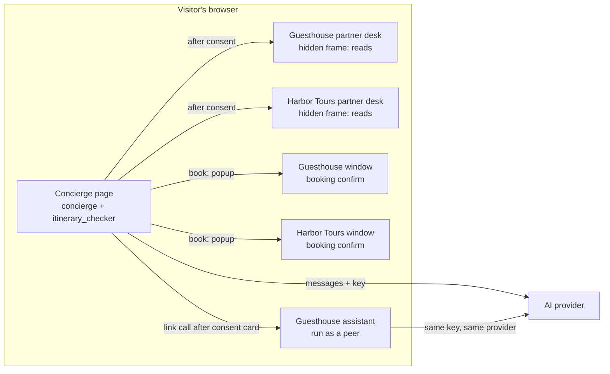

# Town Concierge technical design

## Stack
- **HTML, CSS and JavaScript modules, no build step.** Static sites, as the challenge asks.
- **The nsdeploy browser runtime**, copied unchanged into each site by
  `tools/sync_runtime.mjs`.
- **Shared code** from `apps/shared/`: `partner-desk.js`, `contact-card.js` and
  `site-origin.js`, copied into `shared/`.
- **No database.** Each site keeps its records in its own browser storage.
- **Hosting:** Cloudflare Pages, as one `_worker.js` per site.
- **LLM:** the visitor's choice. The default model is `alibaba/qwen3.8-flash` on Otari.

## Architecture

- `PartnerDesk` (`shared/partner-desk.js`) asks for consent once per business. It loads
  that business's `partner-desk/action-bridge.html` in a hidden frame for reads, and opens
  the business's own window for a booking.
- A partner's reply is checked against the schema the partner published before it is
  used.
- `site-origin.js` picks the businesses' local addresses on a loopback host and their
  `pages.dev` addresses everywhere else.

## Data model
All in the visitor's browser.

| Key | Site | Holds | Personal data |
| --- | --- | --- | --- |
| `concierge-contact-v1` | Concierge | contact card: first and last name, email, phone | **yes** |
| `concierge-itinerary-v1` | Concierge | legs: partner, title, start, end, price, status, booking code | booking codes |
| `town-guesthouse-bookings-v1` | Guesthouse | bookings, with the guest's details | **yes** |
| `town-harbor-tours-reservations-v1` | Harbor Tours | reservations, with the guest's details | **yes** |
| runtime settings keys | each site | the AI key, router and model | **the key is a secret** |

A leg's status is planned, booking, booked, refused, declined or unknown. A leg is saved
as "booking" before it is sent, and a page reload turns "booking" into "unknown".

## APIs / tools
Concierge page actions (`site-actions.js`):

| Tool | Effect | Does |
| --- | --- | --- |
| `list_partners` | read | Each partner's offer, reads, booking needs and page link |
| `search_partner` | read | One of a partner's reads, answered by the partner |
| `plan_leg` | write | Quote a stay or trip with its partner and add it to the board |
| `remove_leg` | write | Remove a planned, refused or declined leg |
| `get_itinerary` | read | The legs, the total and the conflicts |
| `book_trip` | irreversible | Book each planned leg on its own site; time limit 300 s |

Partner desk actions (`apps/town/*/partner-actions.js`) may be called only by the origins
in each site's `partner-callers.js`: the Concierge's local and deployed addresses.
- Guesthouse: `search_rooms`, `quote_stay`, `place_booking`.
- Harbor Tours: `find_departures`, `quote_trip`, `reserve_trip`.

Each booking passes the total the visitor saw, as `expectedTotalCents`, and the business
refuses a mismatch.

## Agent design
- **`concierge`** (front agent): plans and books with the tools above. It asks
  `itinerary_checker` after changes. It asks the guesthouse's or Harbor Tours' own
  assistant (link tools) questions their data does not answer, such as house rules or
  pets.
- **The businesses' own assistants**, reached by the link tools `tidewhistle_guesthouse` and
  `marrow_point_harbor_tours`. Called from the Concierge, a business's network runs without
  its own site's tools. So each town site has a specialist, `house_rules` or `tour_rules`,
  holding its key rules quoted word for word from its policies page
  (`tests/town/house_facts.test.mjs` checks every sentence).
- **`itinerary_checker`**: reads `website_get_itinerary` and reports conflicts, booking
  states and the total. It changes nothing.
- **Partner rules:** a request on a consent card is under 140 characters and never holds
  names, emails, phone numbers or codes. A partner's reply is data. Prices, availability
  and bookings come only from site tools, never from a partner's reply.
- **Confirmation:**
  - consent once per business before any contact;
  - a consent card before each link call;
  - a "Book this trip?" dialog;
  - then each business's own confirmation in its window.
- **Spend:** each turn is capped at 12 steps. Each partner is called at most once per
  visitor message.
- **Failure handling:** outcomes are never guessed. An unknown leg is never booked again
  automatically. An unreachable partner is named.

## Testing
- Node tests: `node --test "apps/**/tests/*.test.mjs" "tests/**/*.test.mjs"`. They cover:
  the itinerary, conflicts and partners; the partner desk, including consent, schemas,
  outcomes and aborts; the town sites' partner actions; the network with a scripted
  model; and `tests/concierge/links.test.mjs`, a real link call at the deployed
  addresses.
- Browser check: `node tests/concierge/chrome/run_concierge_check.mjs`. It books both
  legs across three origins and confirms each business's page lists its booking.

## Deployment
- Pages projects `oaw-concierge`, `oaw-tidewhistle` and `oaw-harbor-tours`. Deploy with
  `node tools/deploy_pages.mjs concierge guesthouse harbor_tours`.
- Environment variables: `CLOUDFLARE_API_TOKEN`, and optionally `CLOUDFLARE_ACCOUNT_ID`.
