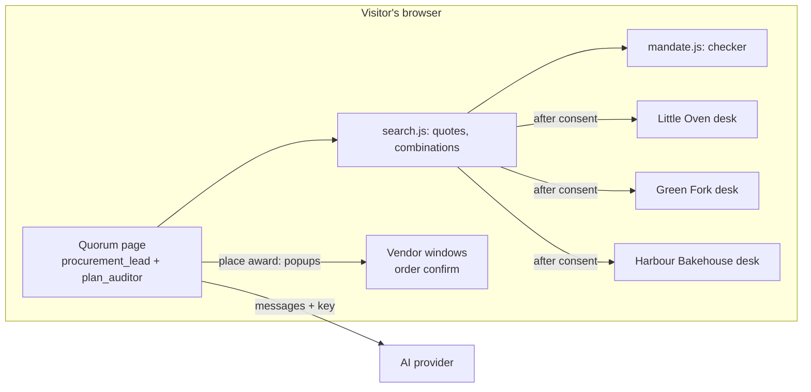

# Quorum technical design

## Stack
- **HTML, CSS and JavaScript modules, no build step.** Static sites, as the challenge asks.
- **The nsdeploy browser runtime**, copied unchanged by `tools/sync_runtime.mjs`.
- **Shared code** from `apps/shared/`: `partner-desk.js`, `contact-card.js`,
  `vendor-pricing.js` and `site-origin.js`. The vendors use `vendor-pricing.js`,
  `vendor-desk.js` and `vendor-page.js`.
- **No database.** Each site keeps its records in its own browser storage.
- **Hosting:** Cloudflare Pages, as one `_worker.js` per site.
- **LLM:** the visitor's choice. The default model is `alibaba/qwen3.8-flash` on Otari.

## Architecture

- `search.js` validates each vendor's catalog. It builds baskets for the separate diet
  groups, asks for quotes across times, fulfilment and splits (at most 60 quotes per
  search), and returns the plans: best, closest, baseline, failures and per-vendor notes.
- `mandate.js` `checkPlan` is the only judge. It counts servings from the vendors'
  menus. It checks every person gets one suitable serving with a max-flow assignment,
  then checks the budget and the time window.
- The vendors' prices come from `vendor-pricing.js` `quote()`, run on the vendor's own
  site.

## Data model
All in the visitor's browser.

| Key | Site | Holds | Personal data |
| --- | --- | --- | --- |
| `quorum-mandate-v1` | Quorum | date, headcount, diet counts, budget, window, flexibility, pickup | no |
| `quorum-award-v1` | Quorum | the current orders: vendor, time, total, status, reference | references |
| `quorum-past-awards-v1` | Quorum | the last 20 finished orders | references |
| `concierge-contact-v1` | Quorum | contact card: first and last name, email, phone | **yes** |
| `market-<vendor>-orders-v1` | each vendor | orders received, with the customer's details | **yes** |
| runtime settings keys | each site | the AI key, router and model | **the key is a secret** |

The contact card uses the same storage key name as the Concierge, but on a different
origin, so they are separate. An order is saved as "booking" before it is sent, and a
reload turns it into "unknown".

## APIs / tools
Quorum page actions (`site-actions.js`):

| Tool | Effect | Does |
| --- | --- | --- |
| `get_mandate` | read | The current rules |
| `set_mandate` | write | Change named fields; drops old plans |
| `list_vendors` | read | Each vendor's menu and rules |
| `request_quote` | read | One binding quote from one vendor |
| `find_best_plan` | read | Search all vendors; time limit 300 s |
| `check_plan` | read | Run the checker on a plan |
| `place_award` | irreversible | Order a plan from `find_best_plan`, each order in its vendor's window |

The vendor partner desk (`apps/market/*/partner-actions.js`) has `get_catalog`,
`request_quote` and `place_order`. These may be called only by Quorum's local and deployed
origins, listed in `partner-callers.js`. Each order passes `expectedTotalCents`.

## Agent design
- **`procurement_lead`** (front agent): sets the mandate on request, finds and presents
  plans, and places orders on request. It asks `plan_auditor` about any plan that the
  visitor or the agent composed.
- **`plan_auditor`**: calls `website_get_mandate` and `website_check_plan`, then explains
  each problem and the smallest fix. It may never call a plan acceptable that the checker
  rejects.
- **Confirmation:**
  - consent once per vendor;
  - a "Place these orders?" dialog listing each order, the total and who it is for;
  - then each vendor's own confirmation.
  - Only the visitor's "Start a new order" button begins a new award.
- **Spend:** each turn is capped at 12 steps, and each search at 60 quotes.
- **Failure handling:**
  - a vendor that stops answering is named;
  - when nothing fits, each vendor's reason is shown;
  - an unknown order is never resent.

## Testing
- Node tests: `node --test "apps/**/tests/*.test.mjs" "tests/**/*.test.mjs"`. They cover:
  the checker, including the diet assignment and attempts to fool it; the search; the
  award; the vendors' pricing and desks; the page; and the network with a scripted model
  and the vendors' real pricing.
- Browser check: `node tests/quorum/chrome/run_quorum_check.mjs`. It places a split order
  across four origins and confirms each vendor's page lists its order.

## Deployment
- Pages projects `oaw-quorum`, `oaw-little-oven`, `oaw-green-fork` and
  `oaw-harbour-bakehouse`. Deploy with
  `node tools/deploy_pages.mjs quorum little_oven green_fork harbour_bakehouse`.
- Environment variables: `CLOUDFLARE_API_TOKEN`, and optionally `CLOUDFLARE_ACCOUNT_ID`.
